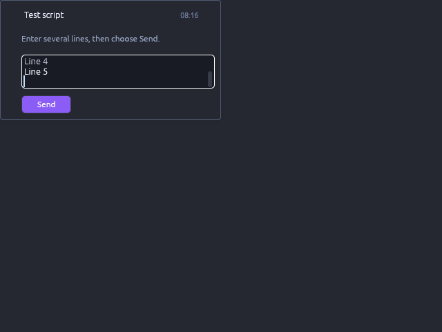
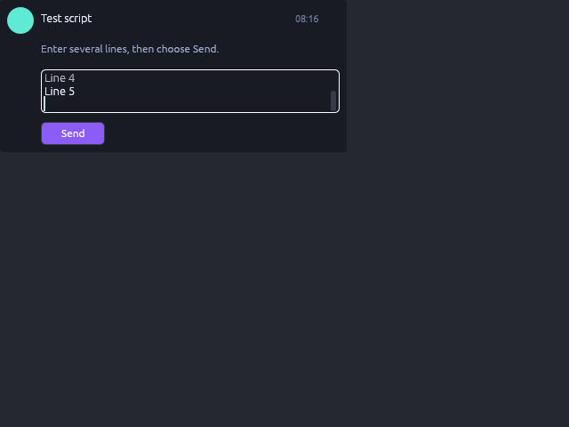

# Foldurora PR #16: multiline script textbox cards

Synthetic component CPU captures from source `d2bbabc6c2723dfdcf1e296be157978884122201`,
base `388b299c429d776b3fc7a9890162cd3d940b9dc3`, upstream port
`b372453d7886bf433e77f161babc3a1d5dd2c224` of
`a92c0e2e33d0638f1cf4b45b47118c297add5754`.

Run [42498152373](https://github.com/DrCum/Foldurora/actions/runs/42498152373),
validation-only workflow commit `4a30357287472751695515f0e482ef37f95bd20b`,
Rust/Cargo 1.99.1, ci profile. The actual Enter/Send regression draws five lines,
focuses the field, presses Enter, captures this pre-Send state and then verifies
Send and original reply addressing. The last three visible rows contain Line 4,
Line 5 and the empty line inserted by Enter. Both images were inspected.

| Legacy | Aurora |
| --- | --- |
|  |  |

Both PNGs are 640x480 at 1x DPI, produced by the existing CPU painter using
synthetic data and the supported opaque test skin. Normal regression runs use
the default skin. No callbacks were dropped. These are component images, not
native/default-glass/Vulkan or grid acceptance. Upstream reference images and
historical human validation are not Foldurora acceptance.

42 unique focused tests passed; the capture test passed again (two styles).
Full workspace: 7,903 passed, 4 failed, 50 ignored. The four unchanged baseline
crash-window/host-overlay fixtures panic on unapplied TexturesDelta, as reproduced
on base in run 42485077208; their corrections belong to the Dev Agent.

Raw log/image artifact: `13625296263`, ZIP SHA-256
`dd5f74c69f573c9973c3ddb0a63363bd44120c94ab3dda7d221fb34babef50c0`.
PNG SHA-256:
- Legacy: `ae15529a2c6320bb6e5b64b212086ce7b60e6b3bfb27df2cbf2aff2e998e3828`
- Aurora: `0b956ffecedc197600d0edb30ad4f1aecdd9dd48b05ed46da25f1b0a3b66fabd`

Native both-style scroll/toast/paste/IME checks, Windows build/package and human
llTextBox received lines/byte count/source routing remain pending. No merge/release.
