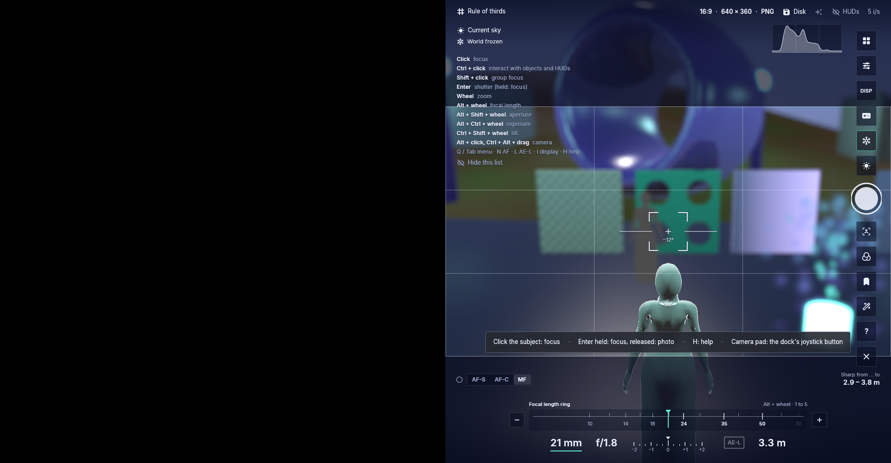
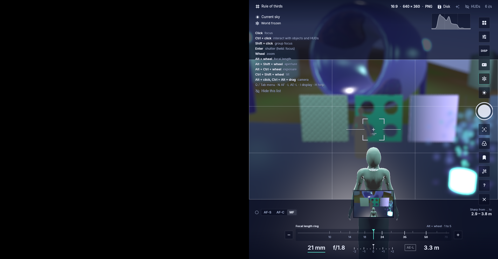
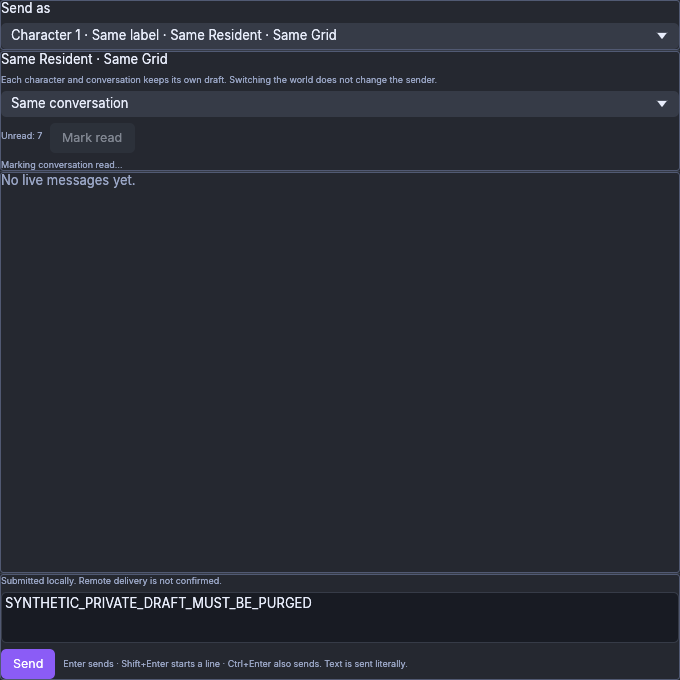
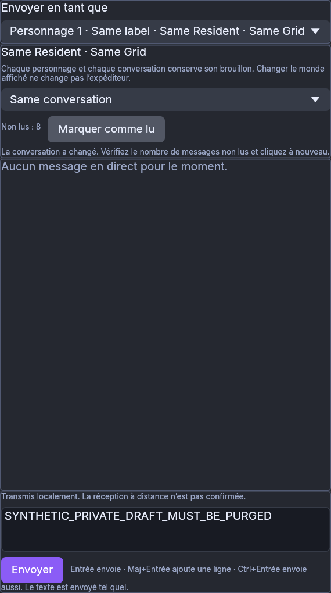
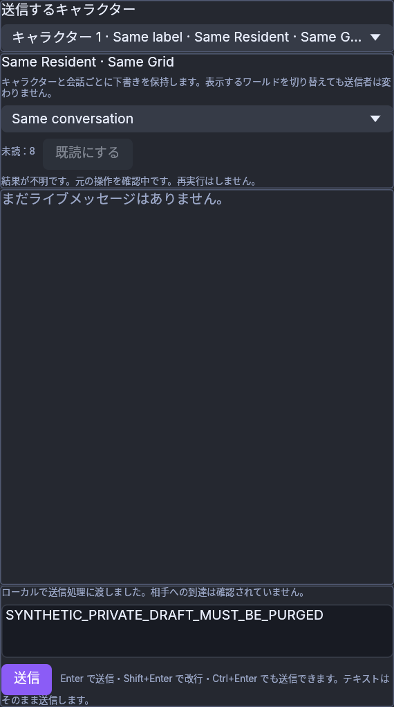
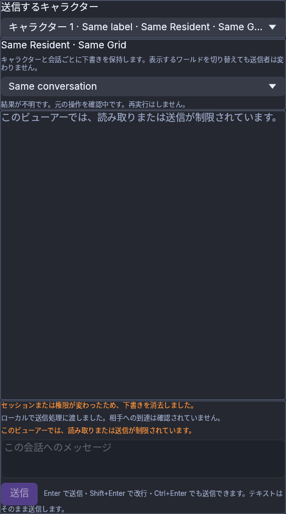

# Native shutter and CPU Read states — frozen 0e40e48f

Exact source: [`0e40e48f631b1b4fdd0d677013e07b83a4f5fc61`](https://github.com/DrCum/Foldurora/commit/0e40e48f631b1b4fdd0d677013e07b83a4f5fc61).
Normal Linux dev executable: `Aurora Viewer 0.0.0+1561.g0e40e48f6`, SHA-256
`825e200e36e40e7519a38e8eaf17fd2429d2d6b08045075c93d3b8d9377d648e`.
All images are unchanged originals; `images.json` records their hashes and scopes.
The native shutter images and synthetic CPU Read images are different evidence.
Neither establishes Windows, physical-GPU, real-account or grid acceptance.

## One native shutter attempt

An owned offline Linux/software-Vulkan demo used a private installation/profile,
1920×1000 window, right-half world, actual Free camera OFF and MF3.3m. The export
folder was empty, then the pointer hovered a clear scene point for2seconds. One
queued native motion/primary-down/up burst on the shutter, with no settled shutter
hover, produced one640×360RGB PNG observed within2.063seconds. There was no retry.
The8,253ns value is a queued XTest request-burst duration, not OS processing latency;
no native event-to-egui-frame boundary is asserted.

Export SHA-256: `dd2c93539cb4e7928e0ec5f6f7c8e668607c6cdefa1fa3a401e9584356364e8d`.
Actual confirmed normal Quit returned viewer/wrapper0 after222.917seconds. All
owned viewer/driver/wrapper processes and the display socket are absent. The
terminated Xvfb zombie awaits PID1 reaping; no live owned display/GPU remains.
No device-loss, panic, stall, watchdog or forced stop was observed.

The source-worktree receipt is
`.scratch/shutter-input-smoke/batch-BpdunVpO/VALIDATION-0E40-SHUTTER-RECEIPT.json`.
The earlier first-click observation on1ef remains unproven as to native frame
ordering. Separately, unchanged actual-egui tests failed against the old shutter
and passed with this completed-primary-click correction, including held/cancel,
secondary exclusion and repeated layout passes.

## Shared Chat Read states — synthetic CPU body

The production Shared Chat body and CPU painter generated16captures in each of
English, French and Japanese (48total), including normal and narrow/150% layouts.
All locale fixtures passed required-text and revoked-text checks; selected screens
were inspected. These are synthetic snapshots, not native windows or authenticated
worker traffic. The literal `SYNTHETIC_PRIVATE_DRAFT_MUST_BE_PURGED` is deliberate
test content: Read pending/stale/uncertain must retain it while permission stays
valid; the later revoked-policy capture must remove it and its Undo state.

Read admission captures source/conversation/native observation, never sends chat
or activates a world, and does not clear a draft. New arrivals/native reads make
old observations stale. Uncertainty queries the original receipt without replay.
Both ordinary native chat styles retain existing read-on-draw defaults/timing;
this slice does not establish passive-read safety or implement Attention/monitors.
Real routing, native OS input, policy changes and IME still need separate checks.

Full Linux runtime checkpoint08099610:7,951passed/one inherited terrain GPU
precision failure/51ignored; all135required regressions pass. Final0e changes only
one lint-equivalent validation guard and passed exact-source formatting, Linux
Clippy with its existing platform dead-code exception,48CPU captures and normal
build. Windows outcomes belong to that run's own manifest and logs.
