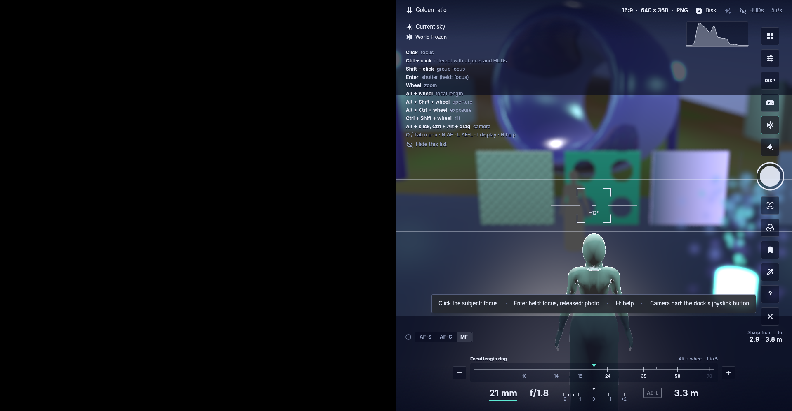
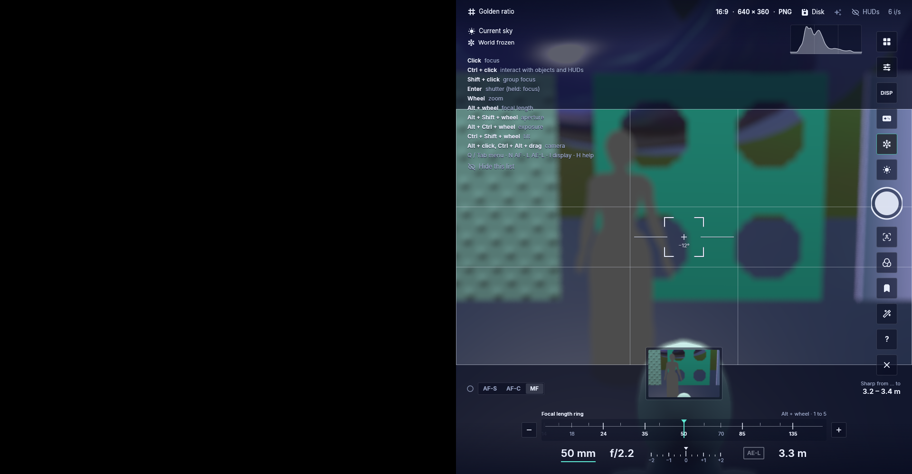

# Combined camera input check — frozen 1ef87bf6

Exact source: [`1ef87bf6d4cfbe54c071009539cdc99cca4d4f34`](https://github.com/DrCum/Foldurora/commit/1ef87bf6d4cfbe54c071009539cdc99cca4d4f34).
Normal Linux dev executable: `Aurora Viewer 0.0.0+1553.g1ef87bf6d`, SHA-256
`1c8c2caa79275caaa9607010e5b235d1ce7ace6dde3033c91ab0e9135f768f1f`.
These unchanged original captures belong to one owned offline software-Vulkan demo,
1920×1000, right-half world and actual Free camera OFF. They are not Windows,
physical-GPU, live Shared Chat, grid or performance acceptance.

The histogram visibly clears the right-edge dock. After a settled hover over the
scene, one queued native motion/press/release burst on the guide changes Thirds
to Golden ratio while AF brackets remain at (1440,500), MF 3.3 m. Another burst on
Settings opens the drawer without moving that point. The measured 7,952 ns and
8,943 ns values are XTest **request-burst durations**, not OS processing latency.
The case did not instrument native event-to-egui-frame boundaries.

Plain scene wheel changes framing with focal 21 mm retained; Alt changes 21→25,
ring wheel 25→50. Focus, aperture f/1.8→f/2.2 and focal reselection respond;
minus 50→35 and plus 35→50 work. After the saved photo, plain wheel retains 50 mm
while framing changes; Alt 50→44, ring 44→24, minus 24→10 and plus 10→24 respond.
Those observations establish response, not step-size equivalence between controls.

**A first shutter click remains an unresolved observation in this source.** Its
unobscured control, MF 50 mm/f2.2/3.3 m settings, immediate capture and later status
checks show no export for about 30 seconds. After a fresh 2-second hover, a second
click at the same (1867,430) position exports a 640×360 RGB photo with thumbnail.
The exported original SHA-256 is
`99208c2bb2814473d47e6f86c512c66143016bd6fba47494f0fdd795ec0162da`.
This is not a blanket shutter-input pass. A subsequent source-only fix for a
completed click between rendered frames is being tested separately; its behavior
is absent from these captures, and the native first-click cause remains unproven.

Actual confirmed normal Quit returned 0 after 384.472 seconds; interactive driver
and wrapper returned 0. Viewer/driver are absent, the display socket is gone, and
both owned Xvfb instances are terminated zombies awaiting PID1 reaping. There is
no running owned display/GPU process and no loss/stall/panic/watchdog failure.
An initial non-interactive driver-ready invocation launched no viewer and is not
counted as a test. The source-worktree receipt is
`.scratch/combined-camera-input-smoke/batch-Q5zN8mIM/VALIDATION-1EF-CAMERA-RECEIPT.json`,
with separate first-shutter and process-cleanup records.

The left black half is intentional. The synthetic world is frozen, and shallow
manual-focus bokeh is deliberate; this is an input check, not a sharpness test.
`images.json` pins unchanged originals.

| Capture | Observation |
| --- | --- |
| [Guide before](guide-before.png) | Thirds, centered AF point, clear histogram/dock |
| [Fast guide after](guide-fast-after.png) | Golden ratio with unchanged AF point |
| [Fast Settings](settings-fast-after.png) | Drawer opens without AF drift |
| [Free camera setting](settings-lower.png) | Actual Free camera OFF |
| [First shutter](photo-requested.png) | No observed export/thumbnail after the first click |
| [Second shutter](photo-confirmed.png) | Thumbnail after the later successful photo |
| [Post-photo Alt](post-photo-alt.png) | Focal 44 mm |
| [Post-photo plus](post-photo-plus.png) | Ring controls remain responsive, focal 24 mm |
| [Quit confirmation](quit-confirmation.png) | Confirmed normal exit recorded separately |

