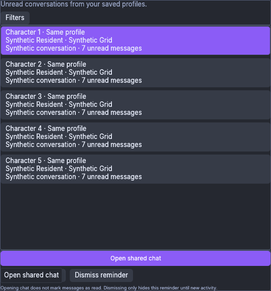
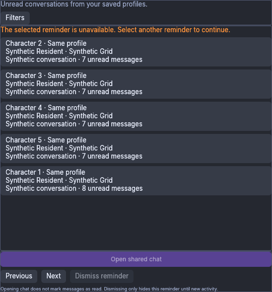
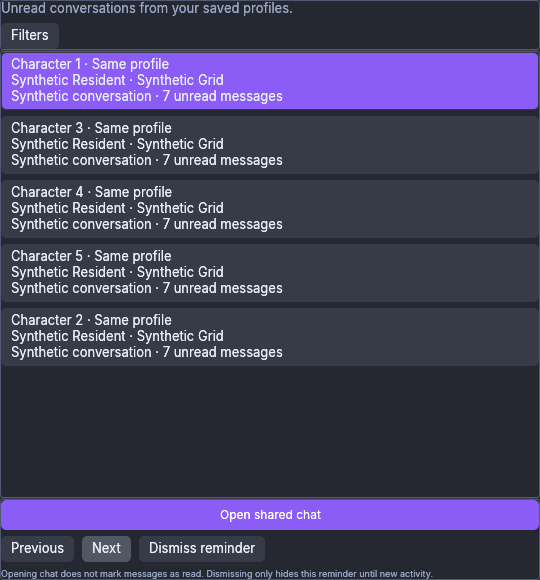
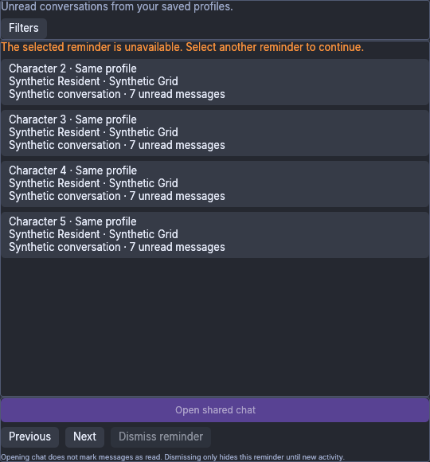
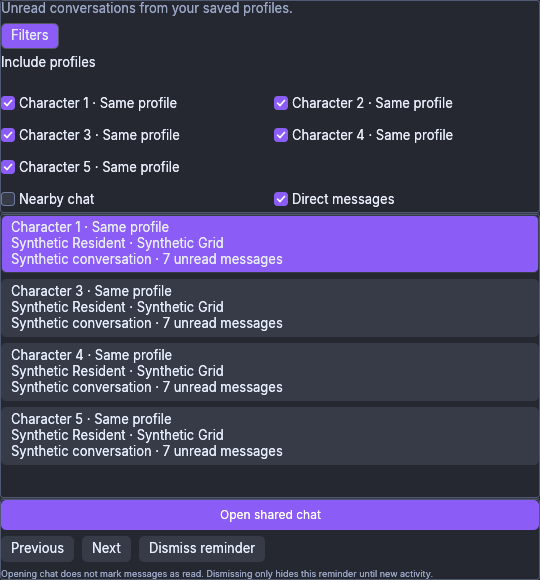

# Native Attention CPU component evidence — 7 November 2026 UTC

These six **original, unchanged PNGs** are copied byte for byte from
`suite-ss3i70g1`. They were not resized, edited, combined or recaptured. The
production AttentionWindow received real isolated X11 input, with synthetic
body-free profile/account/grid/conversation snapshots and recorded local intents.
A screenshot shows the window; input and effect assertions come from the
[unchanged independent receipt](independent-receipt.json), not from its pixels.

Exact source: [`2d8094224e1b44f2cc557d944b9db10ad51e3886`](https://github.com/DrCum/Foldurora/commit/2d8094224e1b44f2cc557d944b9db10ad51e3886).
Test ELF: **775,619,920 bytes**, SHA-256
`99ee531b6c3c5c274598982d656b88884f98138fa89f7991bbee09cb57442232`.
Driver SHA-256:
`f0f80738ba23a605ba1ccedee54e7b9144619e11da4d141b29ac280651599067`.
This test ELF is distinct from a normal viewer executable or Windows package.

The independent archived-evidence audit passed **all six isolated cases**:
Enter, Space, stale incoming/policy/source captures, Previous/Next navigation,
local Dismiss/reopen, and queued/failed/retried simulated preferences. It checked
**102 published states, 96 case checks and all 36 original PNG hashes/dimensions**.
This gallery is a six-image subset of those 36 captures. The suite took
**63.864 seconds**. Each fixture exited normally with code 0, was reaped and
needed no forced cleanup. Six distinct fixture PIDs and displays are recorded
in the receipt. Xvfb servers were honestly reported as **present, Z,
exited-unreaped and not running**; all were already Z at the first grace
observation, so this run did not exercise an actual S-to-Z grace transition.

Held-key checks retained the exact event/effect authority: the first real held
press was repeat=false, followed by three Enter/two Space server true repeats,
with no premature physical release. Fresh gestures produced exact local Open
intents. Stale captures and replaced adjacent targets did not substitute a new
target. Dismiss and preference scenarios preserved synthetic native-read metadata.
Queued preference tickets survived close/reopen; simulated failure kept published
settings and a fresh exact retry applied the requested values.

**Native wheel edges: 0.** All seven filter controls already fit this 540×580
window. This proves visible reachability here, not native wheel/offscreen scrolling.

This is **component evidence only**. The separate full 2d809 workspace run failed:
**8,137 passed, 16 failed, 55 ignored**, including 15 new failures and the inherited
terrain precision failure. These captures do not waive those failures or establish
full-suite success, native Review, Shell/Shared Chat delivered-edit routing,
Worker/World authority, activation/read/send, authentication/IPC, preference-file
IO, Windows, GPU/multiple monitors, real IME, real profiles, credentials or grid
acceptance. Native read-on-draw defaults/safety are not changed or established.
No result transfers to the separate verified 15d Windows package or later sources.

[manifest.json](manifest.json) records original names, dimensions and hashes;
[SHA256SUMS](SHA256SUMS) covers this publication. Only these six PNGs, this scope
note, the compact manifest/checksums and the independent receipt are published.
Private raw state, Xauthority, cookies, logs and executables are excluded.

## Held Enter remains inert before physical release

## Space after release away and a fresh captured gesture

## Retired source leaves the captured selection unavailable

## Replacing the held Next target does not substitute another

## A new reminder incarnation does not revive the old action

## All five profile filters and both category filters fit without a wheel edge

