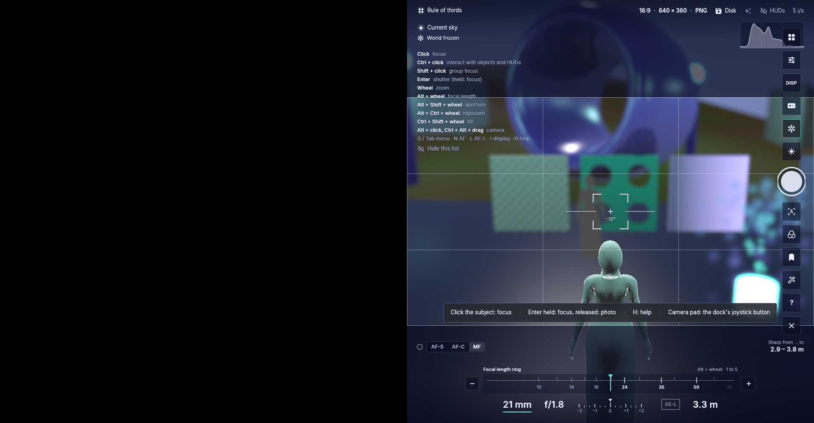
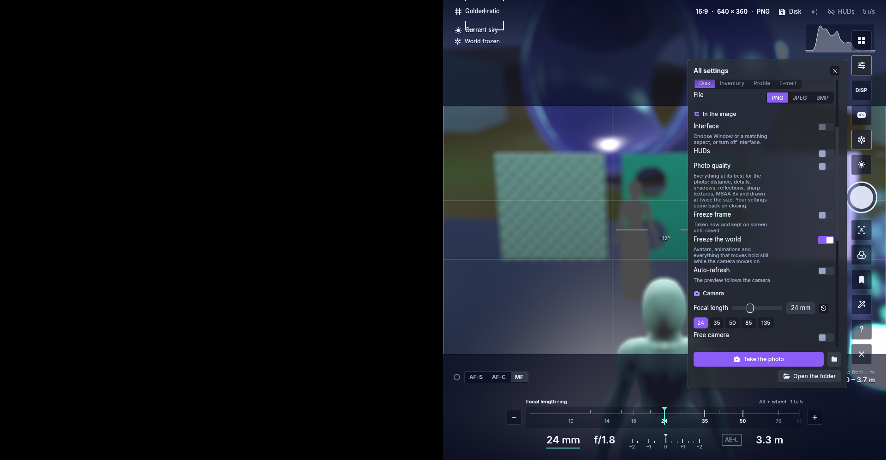
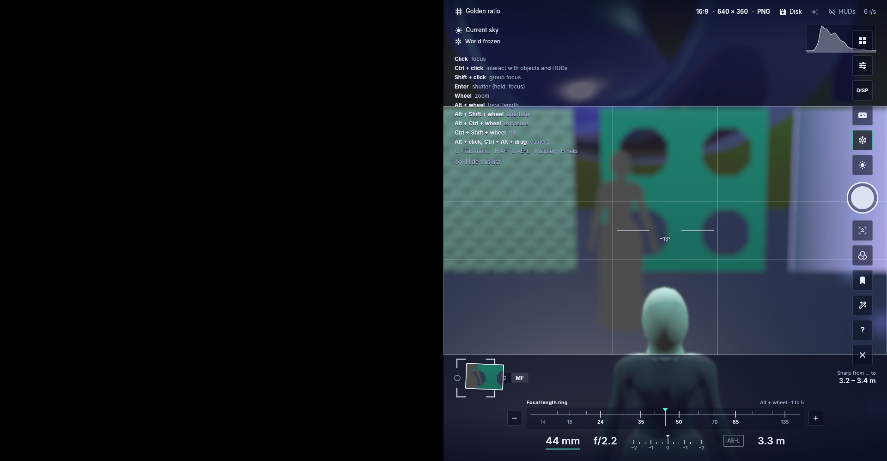

# Camera input check — frozen 6a3009f2

Exact source: [`6a3009f27a2a5e49e61ea0fdeb1f7e89e3eb2fa8`](https://github.com/DrCum/Foldurora/commit/6a3009f27a2a5e49e61ea0fdeb1f7e89e3eb2fa8).
Normal Linux dev binary: `Aurora Viewer 0.0.0+1542.g6a3009f27`, SHA-256
`41c0992e7b57ea6a808b8c7f5899133548d04cdb516ba4799d5f1dd31b06c01e`.
These unchanged native-window captures come from one isolated offline demo using
software Vulkan, 1920×1000 pixels, a right-half world and explicit Free camera OFF.
They contain synthetic scene data. Windows, physical GPU and human grid acceptance
are separate; these captures are not a release or performance result.

Plain wheel changed ordinary camera framing while retaining the focal value;
Alt+wheel changed selected focal 21→23 mm; ring wheel and −/+ continued responding
after Settings, aperture, focus, looks and a real photo/readback. The shutter saved
a 640×360 RGB PNG. After the photo, −135→85, +85→135, ring wheel135→50,
Alt wheel50→44 and plain scene wheel with44 mm retained all responded. Actual
confirmed Quit exited0 after617.289 seconds; driver/wrapper0, all owned processes
and the private display were removed. There was no loss/stall/panic marker.

**Two follow-ups remain in this frozen source:** the top dock covers part of the
histogram, and a UI click can also relocate the focus point before the next egui
frame. Guide changes Thirds→Golden ratio but the AF brackets also move from
(1440,500) to the guide click(1050,24); MF distance stays3.3 m. Neither finding is
fixed in6a. Corrections are being validated in the later combined Shared Chat
candidate. Do not transfer that candidate's results to these images.

The left half is expected black space, not a failed render. Shallow depth of field,
manual focus and long focal values make the exported/photo scenes deliberately
blurred; this is an interaction check, not a sharpness comparison. The first
startup-world capture is not used as evidence. `images.json` records hashes of
all unchanged originals selected here.

| Capture | Observation |
| --- | --- |
| [Initial viewfinder](viewfinder-reference.png) | Right-bound scene, right-edge dock and centered ring; histogram overlap visible |
| [Guide response](guide-button-response.png) | Golden ratio selected, with the separately tracked focus-point leak |
| [Plain scene wheel](baseline-scene-wheel.png) | Framing changes, focal remains21 mm |
| [Alt wheel](baseline-alt-focal.png) | Focal becomes23 mm |
| [Settings](settings-lower.png) | Actual Free camera switch is OFF |
| [Photo/readback](photo-requested.png) | Successful capture and on-screen thumbnail |
| [Post-photo wheel](after-photo-scene-wheel.png) | Ordinary wheel remains responsive after the photo, focal44 mm |
| [Quit confirmation](quit-confirmation.png) | The real confirmation was clicked; return status is recorded separately |

