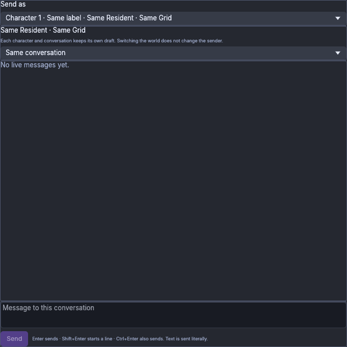
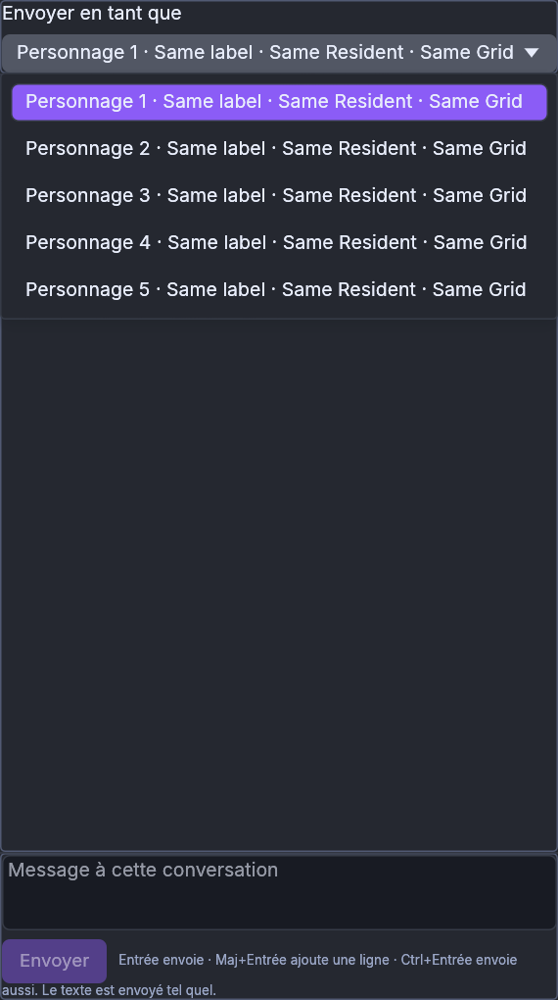
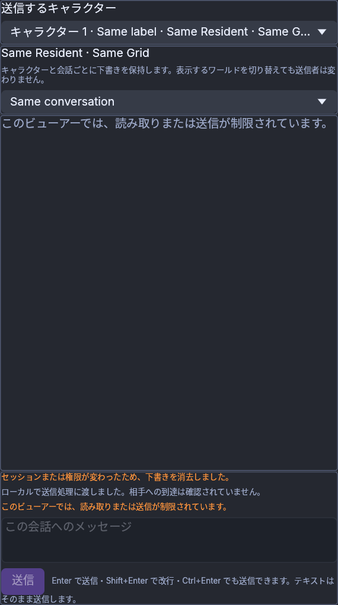

# Shared Chat CPU captures — 7b2298e8

Exact runtime checkpoint: [`7b2298e808e0be8af1df46c540f87b4e9fccea7a`](https://github.com/DrCum/Foldurora/commit/7b2298e808e0be8af1df46c540f87b4e9fccea7a), retained in the later combined `1ef87bf6` candidate. These are unchanged originals from the production Shared Chat body, rendered by the production CPU painter with actual egui input. They contain synthetic identities and conversations. They are not native OS windows, live grid sessions, performance results or human acceptance.

The explicitly configured ignored `shared_chat_cpu_visual_fixture` passed independently in English, French and Japanese, ten captures per locale: selected identity, duplicate labels, pending receipt, reopened policy and unavailable selection at normal and narrow/150% layouts. All thirty passed required-text and revoked-text checks. `images.json` pins the hashes of the selected originals below. The complete fixture logs/manifests remain in the source worktree's `.scratch/shared-chat-visual/batch-9c7b_b0i`.

This first stage selects a sending character and an existing conversation without changing the active world or marking read. Shell retains at most five exact-source composers while native windows are disposable. An unavailable selected source never silently chooses another sender. Policy/source loss removes affected text and Undo. Native Windows input, human-managed character/conversation delivery, reconnect/privacy behavior and real IME acceptance remain separate checks. Unread/explicit Read, Attention and monitors are later stages, absent from these captures.

| Capture | Observation |
| --- | --- |
| [English identity](en-normal-01-selected-identity.png) | Profile selection plus the actual account/grid identity and a separate conversation |
| [English duplicate labels](en-normal-02-five-duplicate-labels.png) | Five bounded choices retain stable character numbers even with identical synthetic names |
| [English narrow/150%](en-narrow-150pct-01-selected-identity.png) | Truncated selector retains a separate account/grid row |
| [French narrow/150%](fr-narrow-150pct-02-five-duplicate-labels.png) | The same production selector at the localized narrow layout |
| [Japanese policy reopened](ja-narrow-150pct-04-policy-reopened.png) | The revoked draft/history remain absent and controls reflect the current denied policy |

