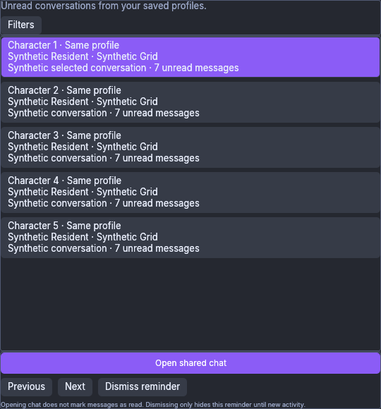
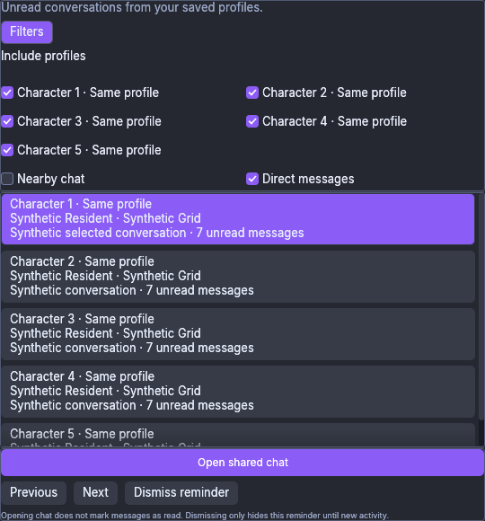
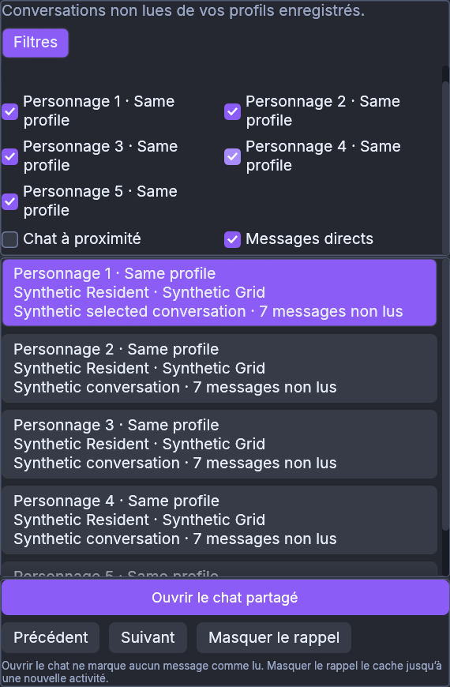
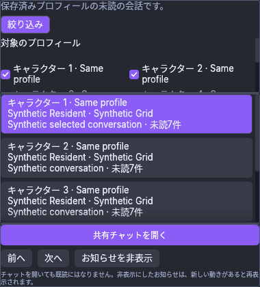
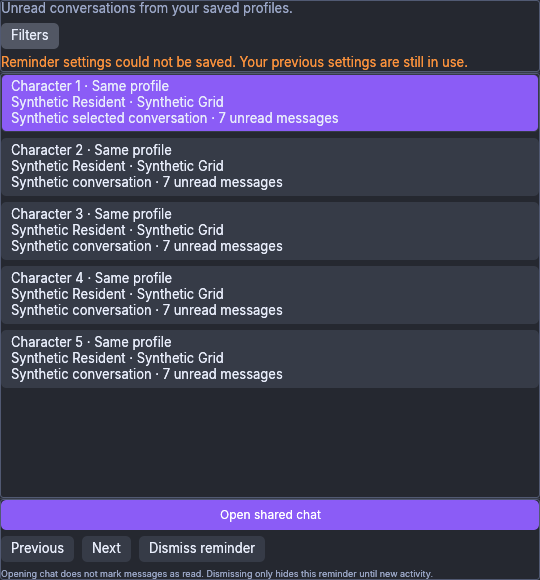
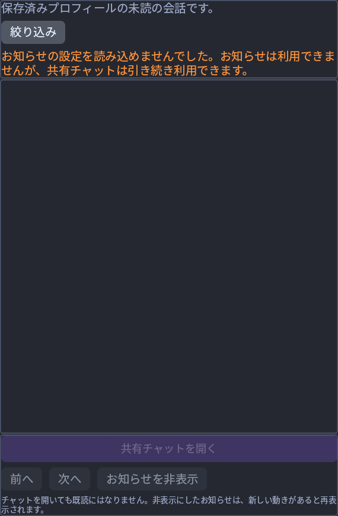

# Attention production CPU UI — 7 November 2026 UTC

These six original PNGs are copied byte for byte from the production Attention
body rendered by egui and the software CPU painter with synthetic snapshots.
They have not been edited, resized, combined or recaptured. All profile labels,
account/grid identities, conversation titles, policies and unread observations
are synthetic. No transcript or draft copy is held by the Attention body.

Exact source: [`9a6918b4e7334e4da319449b56e985107e6b5cd5`](https://github.com/DrCum/Foldurora/commit/9a6918b4e7334e4da319449b56e985107e6b5cd5),
pushed on `feat/attention-integration`.
Test ELF SHA-256:
`a5f017ee4d2834c3cbbf6b6e4794007c16ca3c98bdf4025ae70db23dc043cbfc`
(770,055,472 bytes). The test executable is distinct from a normal viewer build.
The fixture is `session_host::attention_ui::visual::attention_cpu_visual_fixture`.

The exact-source Linux run passed all **203 required checks** exactly once and
all **54 CPU captures**: 18 each in English, French and Japanese. The full Linux
workspace result was **8,020 passed, one inherited terrain precision failure,
53 ignored**. Clippy passed with the existing Linux `dead_code` allowance.
The original [root validation receipt](validation-receipt.json) records the
commands and these separate outcomes. The three unchanged full-run manifests
([EN](manifests/en.json), [FR](manifests/fr.json), [JA](manifests/ja.json)) retain
all 54 captures' required-text, clipping and privacy results. This gallery
publishes only six of those images; the other manifest image names are inventory
entries, not additional published PNGs. [SHA256SUMS](SHA256SUMS) and
[manifest.json](manifest.json) identify the original publication’s copied files
and original names; the checksum list also covers the later normal-build receipt.

The exact 9a normal Linux viewer build subsequently passed in **321.083 s**
from clean tracked source. Its version is `0.0.0+1579.g9a6918b4e`,
670,553,544 bytes, SHA-256
`b05f7500462de2e7f2dcf7fdf7ff9287f16ba3bbcad26fa1e0ea6e51b26901ed`.
The unchanged [normal-build receipt](normal-build-receipt.json) is separate from
the test ELF/CPU capture receipt. Build success is not a native viewer launch.

[Windows run 42385255872](https://github.com/DrCum/Foldurora/actions/runs/42385255872)
for exact 9a is now verified as an **overall failed candidate**: strict Clippy
rejected the unused production `Preferences::includes` helper. Tests measured
**7,991 passed, zero failed, 52 ignored**, with all 203 required names passing
once in both raw and packaged logs; build/package/static icons and integrity
checks passed. Both package manifests report `all_checks_passed=false`; passing
tests and package creation do not make this a green Windows candidate. Artifact
[13581251607](https://github.com/DrCum/Foldurora/actions/runs/42385255872/artifacts/13581251607),
version `0.9.3-beta.20261106.1+205.g9a6918b4e`, retains this negative outcome.
Portable ZIP SHA-256:
`e0c3855a6ed431ed2a6b13c880473f702cb30a41629b4f42b9c8ba984a2bb015`;
EXE SHA-256:
`585b53ed11045451dacf35029a444cb0951a171818ba574c36c126f77256258b`.
No Windows installation/execution or native acceptance is claimed.

The separate strict-Clippy fix is frozen at
[`15d33e6c9225bb476f224df02446e3d8c8c94c8d`](https://github.com/DrCum/Foldurora/commit/15d33e6c9225bb476f224df02446e3d8c8c94c8d),
on `fix/attention-windows-clippy`: one equivalent production helper use and the
workflow branch allow entry. Its
[new Windows run 42390650825](https://github.com/DrCum/Foldurora/actions/runs/42390650825)
is **pending verification**. The old branch/images/receipts remain exact 9a;
none of their measured results transfer to 15d without its own verification.

The first Attention slice includes five stable saved-profile filters, Nearby
and existing Direct conversations (Direct on, Nearby off by default), a local
Dismiss reminder action and passive Open shared chat/Previous/Next navigation.
Opening chat does not mark unread messages as read or activate a World. Saved
checkmarks follow published preferences; the save-failure scene retains the
previous settings. The simulated load failure hides reminders and disables
Attention actions while the separate host/shared chat remains usable.

Normal scenes use 540×580 logical pixels at 100%; narrow scenes use 380×580 at
150% (570×870 physical pixels); the short scene uses 380×420 at 100%. Expanded
filters scroll within a bounded viewport. The narrow bottom scene follows real
egui wheel events in the CPU fixture. The 380×340 native minimum is covered by
an actual-egui pointer/layout regression, not by these 420-pixel-high images.
A scene can intentionally clip offscreen list/filter rows; full-run checks
require each intended field in the appropriate top/bottom or scrolled scene.

This is CPU UI evidence, not native-window/OS-input, Windows, GPU, real IME,
authentication, preference-file IO, Shared Chat/World submission or grid
acceptance. No real profiles, broker, worker, login or live network are used by
this fixture. Native Review, monitors and chat protocol V3 are outside this MVP.
The separately source-reviewed native Attention fixture and external driver have
not been compiled or run. The separately measured Linux normal build and negative Windows candidate are
recorded above; neither result is inferred from these images.

## English selected reminder, filters collapsed — 540×580

## English expanded profile and category filters — 540×580

## French expanded filters, scrolled to the bottom — 380×580 at 150%

## Japanese short expanded-filter window — 380×420

## English simulated save failure retains published settings — 540×580

## Japanese simulated load failure disables reminders — 380×580 at 150%

