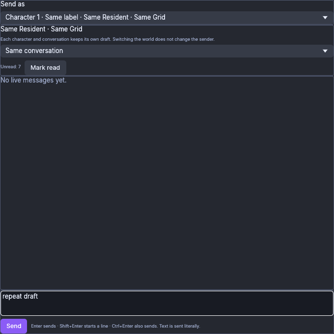
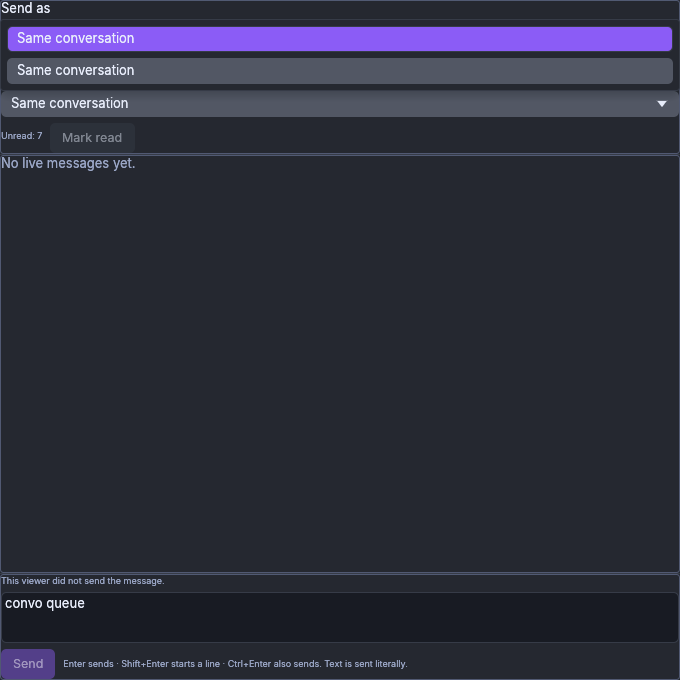
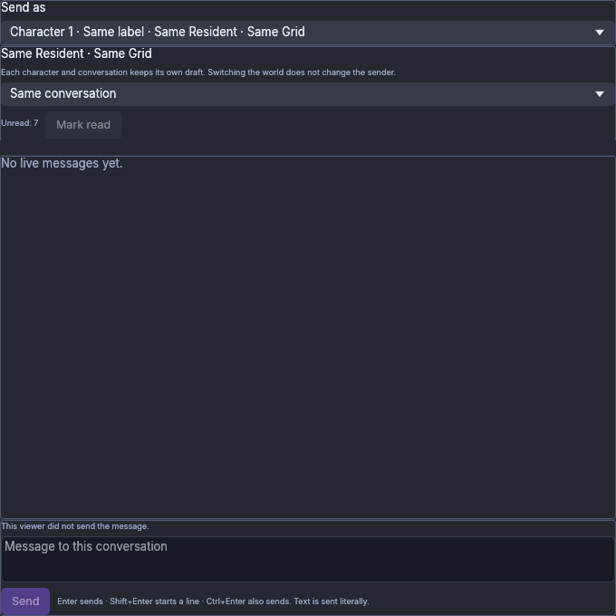
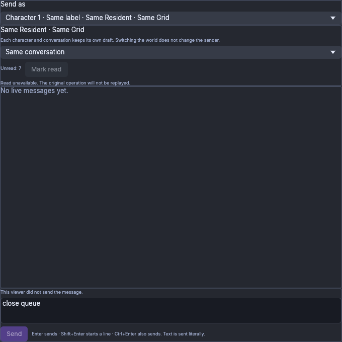
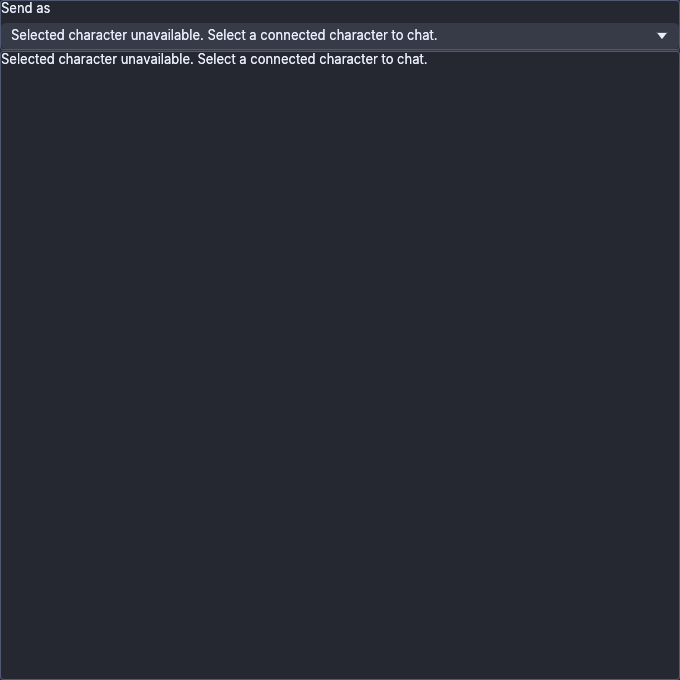

# Native Shared Chat CPU input — b54b2c28

These five original PNGs are unchanged native Linux CPU-window captures, using
real X11/XTest input with the production ChatWindow/egui-winit/software painter.
All identities, policies, drafts and receipts are synthetic. No broker, real
profile, viewer authentication, chat IPC socket, worker, World or grid submission
is involved. Private X11 display/authentication serves only the test windows.
The images do not show a Windows build or physical GPU rendering.

Runtime source: `b54b2c28f2ccadc7ce05c18a4badafea14ff2d08`, version
`0.0.0+1565.gb54b2c28f`. The Linux test ELF SHA-256 is
`dd07fca80a79a0fff67c140a86af704974e7ab2f7072b6f99fe2e4af4246e77e`.
Shipping candidate `6b512b1a` differs only in workflow/documentation; these
images retain their actual b54 source identity.

The full scripted case passed 15 assertions, exactly three typed synthetic Send
intents and one Read intent. It verified held-Enter/refocus suppression with
current sendable draft/no Pending state before any intent, physical-release then
fresh Enter, Shift+Enter/Ctrl+Enter, source/conversation draft retention, captured
Read, native CloseRequested/reopen retention and held-Read source replacement.
The final trace has three eligible true-repeat events before real release; the
earlier held screenshot/state contains two. Checked test and wrapper both exited
0 after 64.407 seconds; no forced stop or live owned process/display remains.
A terminated Xvfb zombie awaits PID1 reaping.

The separate reviewed driver revision changes only conversation-row geometry
acquisition/rechecks/captures, importing the frozen original driver. It preserves
all text, intent and Enter expectations. An earlier unchanged-driver fixed case
already passed the narrow old-negative to fixed-positive Enter comparison but
failed later at an unproven popup target. Both prior negative/partial cases and
all original evidence remain retained. The popup above the selector is observed
in this case, not reconstructed evidence of the old failed click.

`This viewer did not send the message` and `Read unavailable` are controlled
RejectedNative fixture receipts. They are not reports of real delivery attempts.
No World send/read mutation, IPC/authentication, Windows, real IME, window-manager
minimize, caption-button, released-away/refocus or dropping-Shift native acceptance
is claimed. The close event is X11 WM_DELETE_WINDOW, not a caption-button test.
Stable polled row bounds do not establish an interactable egui frame or atomic
event-to-layout timing. Full hashes and source identity are in manifest.json.

## Held Return after refocus, before any typed intent; the valid draft remains.

## Stable requested Direct row before the native click; this case places the popup above its selector.

## One captured synthetic Read intent without a new Send or activation.

## Canonical close queue draft after native close/reopen.

## Source replacement cancels the held Read and removes the unavailable source composer.

