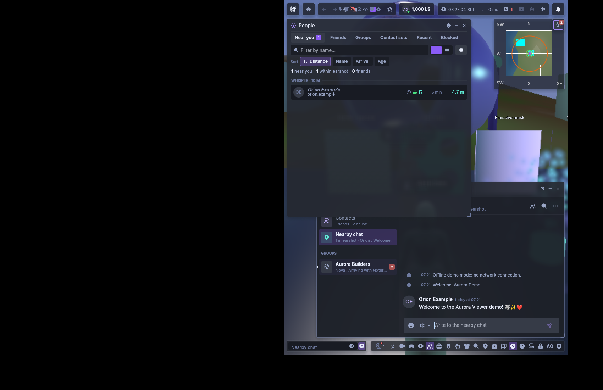

# PR #5 partial UI evidence

Source `f504342231006423d392224f1225bc08e9e32fb5`, version `0.9.3-beta.20261106.1+41.gf50434223`.

The unmodified owned-display PNG shows actual islands, People, chat, minimap and bottom controls inside the right-half world area. The interface is native1600 ×1000 inside a1700 ×1100 synthetic Xvfb desktop. World rendering is50% (the requested25% is clamped by the viewer). All names and messages are offline fixtures.

This is partial evidence. The software-Vulkan fixture timed out at360seconds before required frame700, so Characters, inset/DPI/translated and toggle captures remain pending. It does not establish physical GPU performance, native Windows acceptance or a passing capture suite. No user attachment was published.

